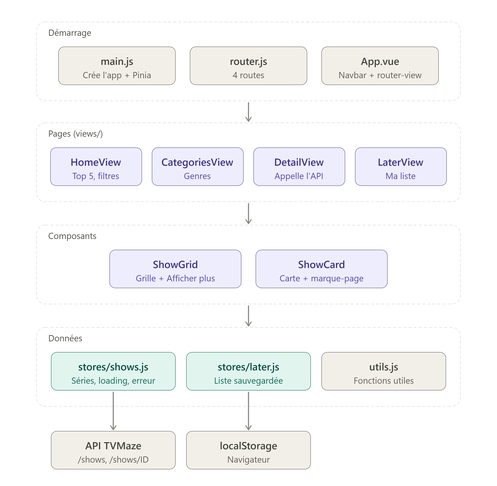
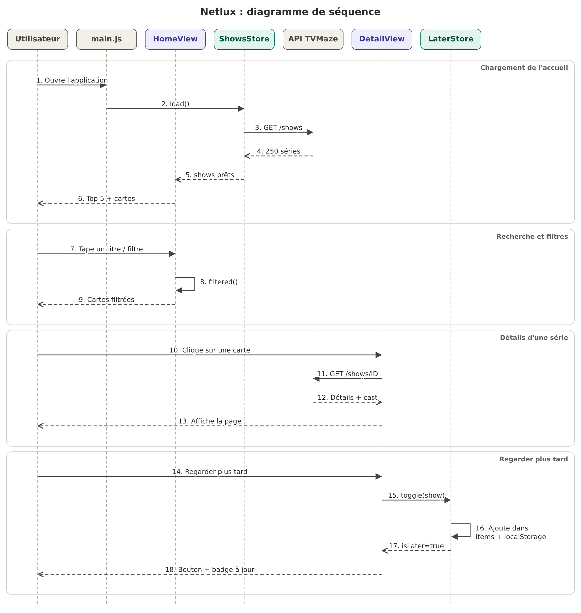
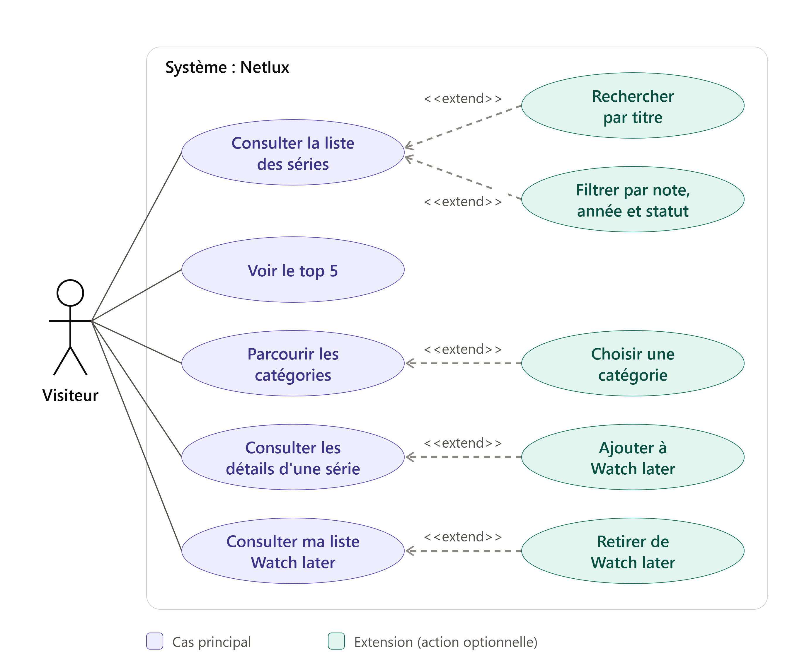

# Netlux

Application web de découverte de séries, inspirée de Netflix.
Les données viennent de l'API publique [TVMaze](https://www.tvmaze.com/api).

 

## Diagrammes

### Séquence

### Cas d'utilisation

## Fonctionnalités

- **Accueil** : top 5 des séries, recherche par titre, filtres (note, année, statut), affichage en cartes.
- **Catégories** : liste des genres, sélection d'un genre, séries correspondantes.
- **Détails** : image, description, note, année, statut, genres, langue, durée, diffusion, chaîne, distribution, liens externes.
- **À regarder plus tard** : ajout et retrait de séries, liste conservée dans le navigateur.
- États de chargement (skeleton), messages d'erreur et bouton « Réessayer » si l'API ne répond pas.

## Stack

| Outil | Rôle |
| --- | --- |
| Vue 3 (Options API) | Interface |
| Vite | Serveur de développement et build |
| Pinia | État partagé (séries, liste « à regarder plus tard ») |
| Vue Router | Navigation entre les 4 pages |
| Tailwind CSS 3 | Style |

## Lancer le projet

Prérequis : Node.js 18 ou plus.

bash
npm install
npm run dev      # http://localhost:5173
npm run build    # version de production dans dist/
npm run preview  # tester le build

## Structure

src/
├── main.js            démarrage, Pinia, router, chargement des séries
├── router.js          routes : /, /categories/:genre?, /show/:id, /later
├── utils.js           fonctions pures (année, note, statut, nettoyage du HTML…)
├── stores/
│   ├── shows.js       séries, loading, error, load() (rejouable)
│   └── later.js       liste à regarder plus tard + sauvegarde localStorage
├── components/        ShowCard, ShowGrid
└── views/             HomeView, CategoriesView, DetailView, LaterView

## Choix techniques

- **Options API** (`data`, `computed`, `methods`, `props`) pour tous les composants et les vues.
- **Pinia** (stores en syntaxe Options : `state`, `getters`, `actions`, utilisés via `mapStores`) pour l'état partagé : les séries sont chargées une seule fois et réutilisées par l'accueil, les catégories et la liste.
- **Filtres en `computed`** : le filtrage se fait en mémoire, sans nouvelle requête.
- **La page détails appelle l'API elle-même** (`/shows/:id?embed=cast`) afin de fonctionner aussi lorsqu'elle est ouverte directement par son URL.
- **La liste « à regarder plus tard » ne stocke que les champs utiles** (id, nom, image, note…), elle s'affiche donc même sans réponse de l'API.
- **Description nettoyée** avant affichage (balises HTML retirées) plutôt que `v-html`, pour éviter toute injection.
- **Images chargées en `lazy`** et rendu par lots de 24 cartes.

## API utilisée

- `GET https://api.tvmaze.com/shows?page=N` (N de 0 à 9) : liste des séries, 250 par page, chargées en parallèle.
- `GET https://api.tvmaze.com/shows/:id?embed=cast` : détails et distribution.

## Limites connues

- Seules les 10 premières pages de l'API sont chargées (environ 2500 séries) ; le catalogue complet de TVMaze est plus grand.
- L'API TVMaze limite le nombre de requêtes (environ 20 toutes les 10 secondes) : si une page échoue, l'application affiche les autres et propose « Réessayer ».
- La liste « à regarder plus tard » est stockée dans le navigateur (`localStorage`) : pas de compte utilisateur, pas de synchronisation entre appareils.
- Pas de tests automatisés pour le moment.
- En déploiement, le serveur doit renvoyer `index.html` pour toutes les routes (mode `history` du routeur), par exemple avec une règle de redirection sur Netlify ou Vercel.

## Pistes d'amélioration

- Charger davantage de pages ou utiliser `/search/shows?q=` pour rechercher dans tout le catalogue.
- Tests unitaires (Vitest) sur les stores et `utils.js`.
- Tri des résultats, mode clair.